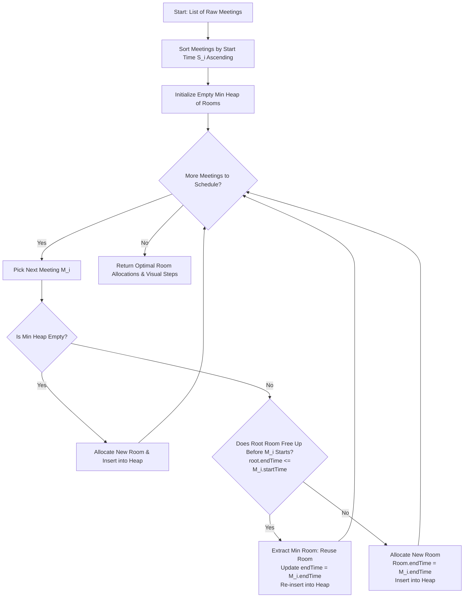

# ⚡ Smart Meeting Room Scheduler

<p align="center">
  
  
  
  
  
</p>

An interactive, visual demonstration of the **Greedy Algorithm** paired with an **in-memory Binary Min Heap (Priority Queue) written from scratch** to solve the classical **Interval Partitioning / Meeting Room Scheduling Problem** using the minimum theoretical number of rooms.

---

## 🌟 Key Features

- 🧠 **Pure Algorithm from Scratch**: Binary Min Heap (`MinHeap`) implemented without third-party data structure libraries (`peek`, `insert`, `extractMin`, `heapifyUp`, `heapifyDown`).
- ⚡ **Optimal Greedy Strategy**: Sorts meetings by start time ($\mathcal{O}(N \log N)$) and always reuses the room that frees up earliest ($\mathcal{O}(\log N)$).
- 📊 **Step-by-Step Heap Visualizer**: Step through each decision showing:
  - Current meeting being scheduled
  - State of the Min Heap tree and internal array before and after
  - Real-time decision badge: `Allocated New Room` vs. `Reused Room`
- 📈 **Empirical Complexity & Metrics Tracker**: Tracks actual heap pushes, pops, comparisons, and sorting comparisons at runtime.
- 🎨 **Modern Dark Glassmorphism UI**: Responsive design with interactive Gantt timeline charts and instant sample datasets.

---

## 🏗️ Algorithm Architecture & Workflow



---

## ⏱️ Complexity Analysis

| Phase / Operation | Algorithm / Data Structure | Time Complexity | Space Complexity |
| :--- | :--- | :--- | :--- |
| **Greedy Sorting** | TimSort (by Start Time $S_i$) | $\mathcal{O}(N \log N)$ | $\mathcal{O}(N)$ |
| **Earliest Room Check** | `MinHeap.peek()` | $\mathcal{O}(1)$ | $\mathcal{O}(1)$ |
| **Room Reuse** | `extractMin()` + `insert()` | $\mathcal{O}(\log K)$ | $\mathcal{O}(1)$ |
| **Room Allocation** | `insert()` | $\mathcal{O}(\log K)$ | $\mathcal{O}(1)$ |
| **Overall Execution** | **Greedy + Min Heap** | **$\mathcal{O}(N \log N)$** | **$\mathcal{O}(N)$** |

*(Where $N$ is the total number of meetings and $K \le N$ is the maximum number of concurrent rooms).*

---

## 🚀 Getting Started

### Prerequisites
- [Node.js](https://nodejs.org/) (v16.0 or higher recommended)
- `npm` (bundled with Node.js)

### Installation & Run

1. **Clone the repository**:
   ```bash
   git clone https://github.com/Vrund1718/Smart-Meeting-Room-Scheduler.git
   cd Smart-Meeting-Room-Scheduler
   ```

2. **Install dependencies**:
   ```bash
   npm install
   ```

3. **Start the Express backend server**:
   ```bash
   node server.js
   ```

4. **Open in browser**:
   Visit [http://localhost:3000](http://localhost:3000)

---

## 🧪 Test Cases & Expected Outputs

### 🔹 Test Case 1: Sequential Non-Overlapping Meetings
- **Input:**
  - Meeting 1: `09:00` - `10:00`
  - Meeting 2: `10:00` - `11:00`
  - Meeting 3: `11:00` - `12:00`
- **Expected Rooms:** **1**
- **Allocation:**
  - `Room 1`: Meeting 1 $\rightarrow$ Meeting 2 $\rightarrow$ Meeting 3
- **Logic:** Meeting 2 starts right as Meeting 1 ends (`10:00 <= 10:00`). Room 1 is immediately reused.

### 🔹 Test Case 2: Peak Concurrency (Fully Overlapping)
- **Input:**
  - Meeting 1: `09:00` - `10:30`
  - Meeting 2: `09:15` - `10:15`
  - Meeting 3: `09:30` - `11:00`
- **Expected Rooms:** **3**
- **Allocation:**
  - `Room 1`: Meeting 1
  - `Room 2`: Meeting 2
  - `Room 3`: Meeting 3
- **Logic:** At `09:30`, both Room 1 (busy until `10:30`) and Room 2 (busy until `10:15`) are active. A 3rd room is strictly required.

### 🔹 Test Case 3: Mixed Overlap (Sample Demonstration Set)
- **Input:**
  - M1: `09:00` - `10:30`
  - M2: `09:30` - `11:30`
  - M3: `10:00` - `11:00`
  - M4: `10:30` - `12:00`
- **Expected Rooms:** **3**
- **Allocation:**
  - `Room 1`: M1 (`09:00`-`10:30`), M4 (`10:30`-`12:00`)
  - `Room 2`: M2 (`09:30`-`11:30`)
  - `Room 3`: M3 (`10:00`-`11:00`)
- **Logic:** When M4 starts at `10:30`, Room 1 frees up at `10:30`. Since `10:30 <= 10:30`, Room 1 is recycled.

---

## 🎤 Viva / Presentation Cheat Sheet (10-Point Summary)

1. **Problem Statement:** Determine the minimum number of meeting rooms required to schedule $N$ intervals without overlap.
2. **Greedy Strategy:** Sort meetings chronologically by start time ($S_i$).
3. **Data Structure:** An array-based **Binary Min Heap** storing occupied rooms keyed by their earliest end time ($E_{min}$).
4. **Root Invariant:** The root element `heap[0]` always holds the room that becomes free earliest.
5. **Decision Rule:** For each meeting $M_i$:
   - If `root.endTime <= M_i.startTime`: **Reuse room** (`extractMin()`, update end time, `insert()`).
   - If `root.endTime > M_i.startTime`: **Allocate new room** (`insert()`).
6. **Time Complexity:** Sorting takes $\mathcal{O}(N \log N)$ and each of the $N$ meetings takes $\mathcal{O}(\log N)$ heap updates $\implies$ Overall $\mathcal{O}(N \log N)$.
7. **Space Complexity:** $\mathcal{O}(N)$ to store rooms and heap nodes.
8. **Proof of Optimality:** If the earliest-freed room is still busy, every active room is busy at that moment (maximum depth of overlap). Allocating a new room is therefore inevitable and mathematically minimal.
9. **Empirical Verification:** The app instruments each heap comparison, push, and pop to demonstrate logarithmic growth in real time.
10. **Zero External Libraries:** The priority queue is implemented manually to demonstrate fundamental DAA principles.

---

## 📂 Project Architecture

```
Smart-Meeting-Room-Scheduler/
├── package.json        # Dependencies & scripts
├── server.js           # Express API & Custom Binary Min Heap
├── .gitignore          # Ignores node_modules and temporary files
├── README.md           # Documentation & Viva Guide
└── public/
    ├── index.html      # UI structure & theoretical complexity panel
    ├── style.css       # Responsive dark-theme styling
    └── script.js       # Client controller & dynamic heap step visualizer
```

---

## 📜 License
This project is open-source and created for academic demonstration of Design and Analysis of Algorithms (DAA).
